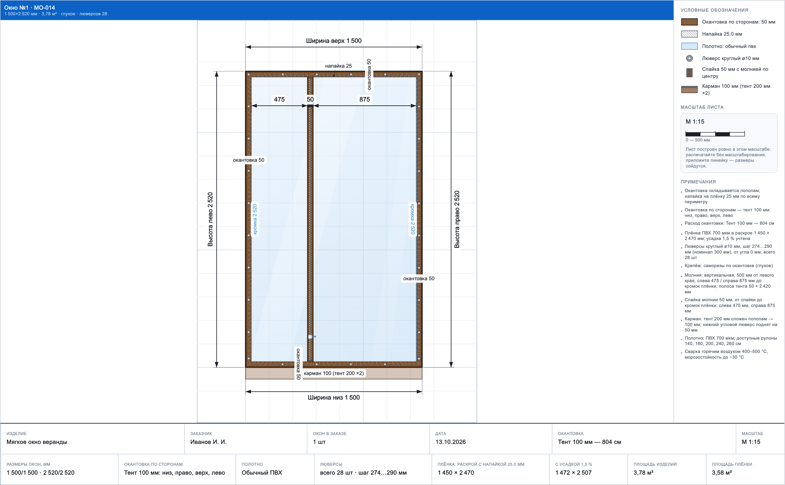
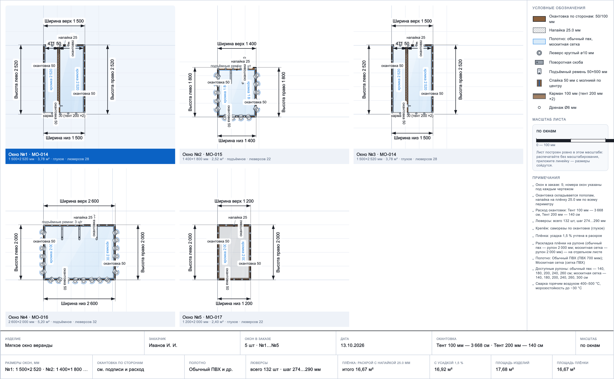
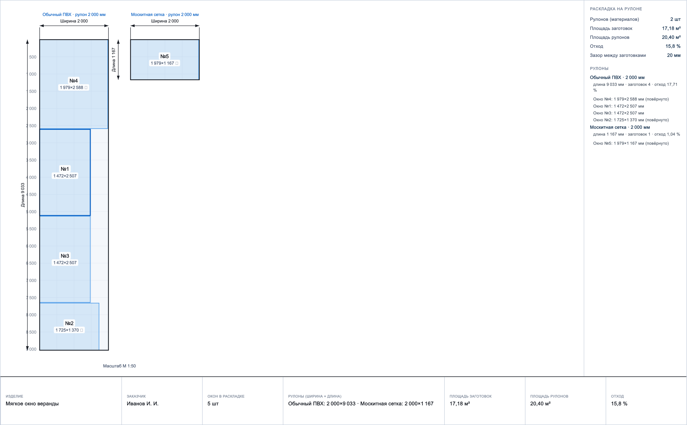
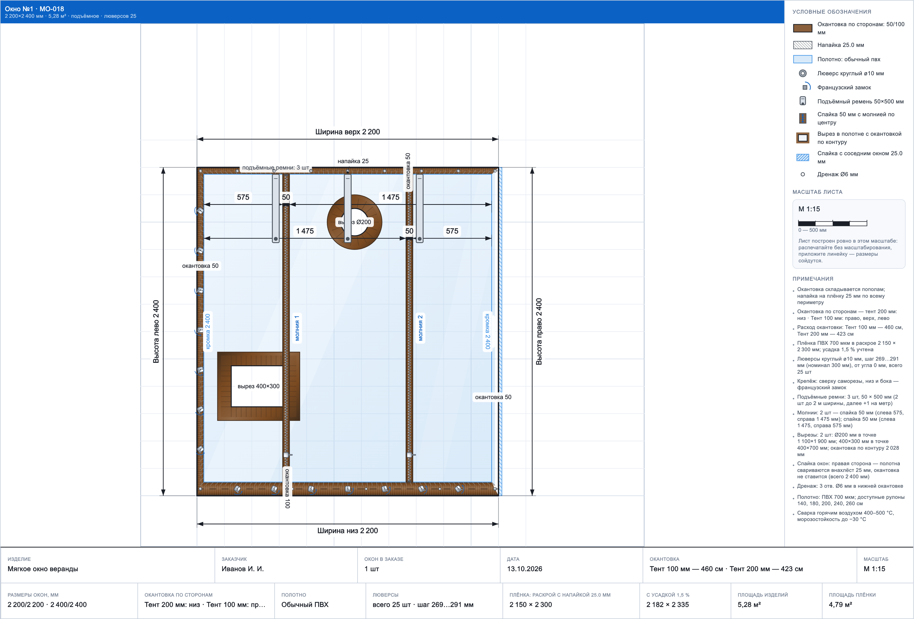
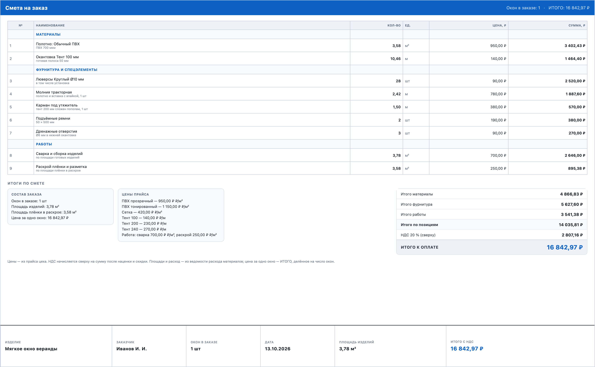
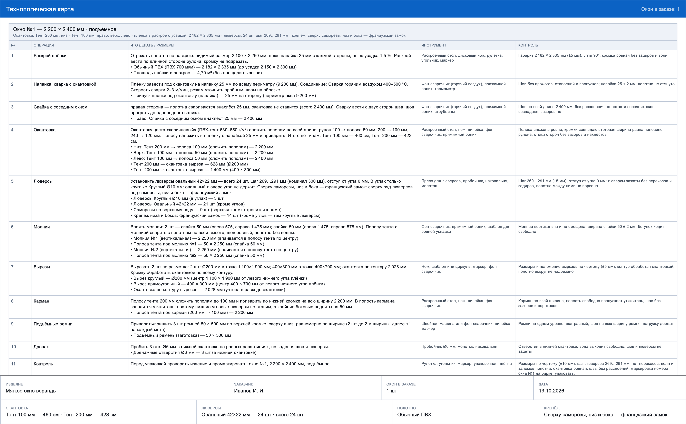
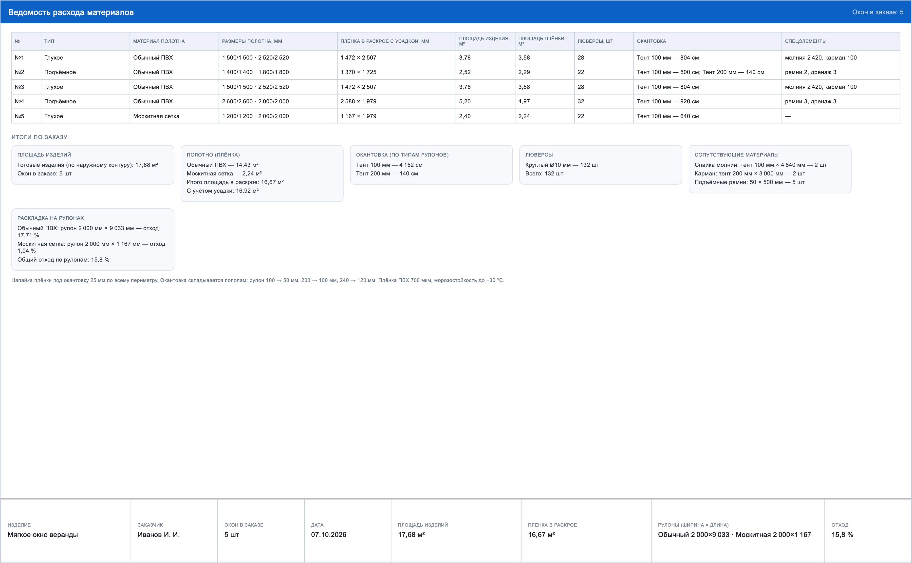

# Мягкие окна — чертежи, раскрой и раскладка на рулонах


Кроссплатформенное приложение (macOS и Windows) для параметрического построения
чертежей мягких окон, расчёта раскроя, раскладки полотна на рулонах
(«тетрис» для расхода материалов), ведомости расхода и сохранения заказов.

**Версия 1.0.2.** Готовые сборки и инструкции по выпуску — в [BUILD.md](BUILD.md)
и в папке `dist/`.

| Чертёж (одно окно) | Заказ из пяти окон | Раскладка на рулонах |
|---|---|---|
|  |  |  |

Подробный режим заказа (одно окно в ряду, лист длиннее экрана — прокрутка и
масштаб колесом): [пример-заказ-подробно.png](docs/пример-заказ-подробно.png).

## Типы окон — только два

| Тип | Что на чертеже |
|---|---|
| **Глухое** | только круглые люверсы по периметру, от угла до угла |
| **Подъёмное** | сверху от угла до угла только люверсы; ниже по бокам и снизу — скобы-прямоугольники; сверху вниз висят подъёмные ремни |

Молния и карман — **отдельные кнопки**, их можно включить у любого типа окна.

## Молния (отдельная кнопка «Добавить молнию»)

- Всегда **вертикальная**.
- Впаивается в полосу тента цвета окантовки — **спайку шириной 50 мм**; молния идёт
  строго по середине спайки.
- На чертеже вокруг молнии стоят **стрелки-размеры**: от внутренней кромки плёнки
  до левого края спайки, ширина спайки 50 мм и от правого края спайки до правой
  внутренней кромки окантовки.
- Молния **двигается влево-вправо**: ползунок в разделе «Молния и карман» или поле
  «Положение молнии от левого края». Положение зажато в границах плёнки.
- В раскрое спайка идёт отдельной заготовкой: 50 мм × высота плёнки.

## Карман (отдельная кнопка)

Карман — **продолжение нижнего тента вниз**: полоса тента, которая по бокам не
спаивается (полость открыта с торцов, в неё заводится утяжитель).

- Делается из тента **200 мм**, складывается пополам → готовая ширина **100 мм**.
- На чертеже это **полупрозрачная накладка от нижней кромки нижнего тента вниз**
  с подписью «карман 100 (тент 200 ×2)»; лист при этом удлиняется вниз, чтобы
  накладка попала в габарит чертежа.
- **Нижние угловые люверсы не ставятся**: они поднимаются на **50 мм** от нижнего
  угла, чтобы торцы кармана оставались свободными.
- В примечаниях и раскрое указывается заготовка тента 200 мм.

## Материал полотна и рулоны

| Материал | Вид на чертеже | Доступные рулоны |
|---|---|---|
| Обычный ПВХ | голубая полупрозрачная плёнка | 140, 180, 200, 240, 260 см |
| Тонированный ПВХ | более тёмная плёнка | 140, 180, 200, 240 см |
| Москитная сетка | светлая заливка с клеткой сетки | 140, 180, 200, 240, 260, 300 см |

Ширина рулона выбирается кнопками из списка **для каждого материала**; раскладка
строится **на отдельном рулоне под каждый материал** заказа.

## Пять и более окон: масштаб и детализация

- Режим листа: **«Одно окно»** (по умолчанию) — выбранное окно крупно, с размерами,
  выносками и легендой; окна переключаются списком «Окно №1…№N» в панели.
- Режим **«Все окна»** — обзорная сетка всего заказа; количество окон в ряду
  выбирается: авто, **1 в ряд (подробно)**, 2, 3 или 4.
- В режиме **«1 в ряд»** лист становится выше экрана: каждому окну даётся своя
  полоса высотой 640 точек, чертёж крупный, подписи уменьшены относительно него.
  Такой лист **прокручивается перетаскиванием и приближается колесом**, а кнопка
  «По размеру» подгоняет его по ширине окна. В PDF длинный лист автоматически
  режется на страницы A3.
- Между окнами нет рамок и границ: выбранное окно выделяется светлой подложкой и
  цветной подписью, номера подписаны под каждым окном.

## Окантовка: своя ширина, шов, расход

Ширина окантовки **вводится руками на каждую сторону** (низ, право, верх, лево) —
от **40 до 400 мм** рулона. Пресеты **100 / 200 / 240 мм** остались как быстрые
кнопки: при нажатии ширина подставляется в поле, при ручном вводе чипы просто
не подсвечены. Полоса складывается пополам, поэтому готовая окантовка — половина
рулона: **100 → 50 мм**, **200 → 100 мм**, **240 → 120 мм**, своя ширина — ровно
`рулон / 2` (под полем подписано, сколько получится).

- **Напайка всегда 25 мм** — на столько плёнка заходит под окантовку по периметру.
  Если готовая полоса меньше 2 × 25 = 50 мм, приложение предупреждает, что
  напайке не хватает ленты.
- **Раскрой плёнки** = наружный контур − 2 × (окантовка стороны − 25 мм);
  видимый размер = наружный контур − 2 × окантовка стороны.
- **Расход окантовки** считается по сторонам без запаса: длины сторон суммируются
  по каждой **ширине рулона**, а не по типу. В смете и ведомости строка
  подписывается шириной: «Тент 150 мм — 150 см».

Пример: окно 1500 × 2520, тент 100 мм на низ/лево/право и 200 мм на верх:

```
Тент 100 мм — 654 см   (150 + 252 + 252)
Тент 200 мм — 150 см
Итого 804 см = периметр наружного контура

видимая плёнка   1400 × 2420 мм
раскрой          1450 × 2470 мм
с усадкой 1,5 %  1472 × 2507 мм
```

**Цена нестандартной ширины.** В прайсе есть цены трёх пресетов (₽/м). Для своей
ширины цена линейно интерполируется между двумя ближайшими пресетами, а за
пределами диапазона 100…240 мм — экстраполируется по ближайшему отрезку: 150 мм
считается ровно посередине между ценой 100 и 200 мм, 240+ продолжает отрезок
200…240. Так смета не «прыгает» в цену соседнего пресета.

## Люверсы

- Идут **от угла до угла**: `шаг = длина стороны / ceil(длина / номинал)`, фактический
  шаг всегда не больше номинала — «хвоста» в углу нет.
- Угловые люверсы соседних сторон склеиваются: каждый угол считается один раз.
- Отступ от угла по умолчанию 0 (люверс в углу), диапазон 0…70 мм.
- Тип: круглый Ø10 мм; овальный 42×22 мм — только у подъёмных окон, у глухих
  всегда круглые.
- Подъёмные ремни: **2 шт при ширине до 2 м**, далее **+1 ремень на метр**
  (2500 → 3, 3200 → 4), заготовка 50 × 500 мм.

## Ввод чисел с клавиатуры

Поля размещают ввод свободно: пока вы печатаете, текст и значение модели
совпадают, поэтому приложение не переписывает поле и **курсор с выделением не
сбрасываются**. Поле обновляется только при внешнем изменении (пресет, смена
окна, «Сбросить»). Незавершённый или неверный ввод сохраняется как есть и
подсвечивается ошибкой.

## Приближение чертежа

- Колесо мыши или трекпад — масштаб, перетаскивание — сдвиг.
- Кнопки `−` / `+`, текущий процент и «По размеру».
- Масштаб не влияет на экспорт: в PDF попадает лист целиком.

## Реалистичная отрисовка и читаемый масштаб

- **Окантовка** — коричневый тент: градиент по толщине полосы, тканевая фактура
  (поперечные и продольные нити), строчка по сгибу, потому что полоса
  складывается пополам.
- **Плёнка** — полупрозрачный ПВХ: видно сетку листа, добавлен косой блик
  (тонированный ПВХ темнее, москитная сетка — с мелкой клеткой).
- **Люверсы** — металлические кольца: радиальный градиент металла, блик,
  фаска вокруг отверстия и само отверстие со светлой подложкой.
- **Поворотные скобы** — пластина с саморезами и проволочная петля, нарисованная
  «трубкой» (тёмный контур, металл, блик) плюс стрелка поворота.
- **Французские замки** — планка с двумя саморезами, поворотный рычажок под 45°
  с осью и дуга поворота на 90° со стрелкой.
- **Молнии** — полоса тента, зоны напайки по краям, два ряда зубцов с замком,
  бегунок с язычком и ограничители.
- **Масштаб** — чертим в честном стандартном масштабе (1:10, 1:15, 1:20 …),
  так что подпись в штампе совпадает с реальностью и с масштабной линейкой.
  Линейка — с чередующимися делениями, подписями и штампом масштаба.
- Толщина окантовки на мелком масштабе не тоньше 5 точек — чертёж читается
  без лупы, даже когда на листе 5 окон.

## Молнии, вырезы и спайка окон

- **Молнии** — до двух на окно (кнопка «Добавить молнию», затем «Добавить вторую
  молнию»): у каждой своё положение (по центру или от левого края слайдером)
  и своя ширина спайки 40–120 мм. Цепочки размеров у второй молнии идут ниже,
  чтобы подписи не налезали.
- **Вырезы** — до четырёх на окно (прямоугольные и круглые) под трубу,
  вентиляцию или стойку: центр задаётся от левого края и от низа полотна.
  Вырез — настоящее отверстие в плёнке, по его контуру идёт окантовка со швом
  напайки, а расход окантовки увеличивается на периметр выреза.
  Программа предупредит, если вырез выходит за полотно, налезает на полосу
  молнии или пересекается с другим вырезом.
- **Спайка окон между собой** — чипы «Спаяно слева» / «Спаяно справа»: на этой
  стороне окантовка не ставится (полотна свариваются внахлёст 25 мм),
  расход окантовки уменьшается, а в ведомости появляется строка про спайку.
  На чертеже такая сторона показана штриховкой и подписью «спайка 25».
- **Люверсы на спайке убираются** — переключатель «Убирать люверсы (крепёж) на
  спаянной стороне» (по умолчанию включён): по сварному шву крепёж только рвёт
  тент. Если по технологии люверсы на спайке нужны — выключите переключатель.
- **В углах всегда круглые люверсы** — овальные 42×22 ставятся только по
  сторонам: угол тянет по диагонали, круглый там держит лучше. Это видно и на
  чертеже, и в легенде.

## Всегда подробный чертёж

Каждое окно на листе рисуется **в подробном режиме** — с размерами, выносками,
кромками и подписями молний, независимо от того, одно окно в заказе или десять.
Лист при этом растёт: одна строка на окно (или на ряд из 2–4 окон), поэтому
ничего не мельчает. Лист одного окна строится по пропорциям окна, а не
растягивается на весь экран, — чертёж получается крупным и аккуратным.

- В углах **всегда круглые люверсы** (овальные 42×22 — только по сторонам):
  угол тянет по диагонали, а на стыке сторон поворотная скоба выглядела бы
  прямоугольником вместо люверса.
- Поворотные скобы, замки и ремни ставятся **по сторонам, не в углах**.

## Удобство работы с заказом

- **«Дублировать»** — копия выбранного окна вставляется следующей: заказ из
  одинаковых окон собирается в два клика, а потом правятся отличия.
- Лист одного окна чертится **в аккуратной рамке по пропорциям окна** (а не
  растягивается на весь экран), в боковой панели — карточка **«Масштаб листа»**
  с линейкой и пояснением, что при печати без масштабирования размеры сходятся
  с линейкой.



## Площадь готового изделия

Везде показываются две площади, чтобы их не путать:

- **площадь изделия** — по наружному контуру окна (габарит): для окна
  1500 × 2520 мм это **3,78 м²**. Именно она идёт в прайс заказчику;
- **площадь плёнки** — сколько плёнки уходит в раскрой с напайкой 25 мм
  (для того же окна **3,58 м²**).

Площадь изделия видна: в раскрое на панели, в подписи окна на листе, в штампе
(«Площадь изделий» / «Площадь плёнки»), в строке итогов внизу и в ведомости
расходов отдельными колонками и итогом по заказу. Для трапеции площадь
считается по четырём углам, а не по габаритному прямоугольнику.

## Вкладка «Смета»: деньги заказа

Прайс-лист живёт в панели слева (раздел **«Прайс-лист»**): цены за м² плёнки по
материалам, за метр окантовки по пресетам рулонов 100/200/240 мм (для своей
ширины цена интерполируется), люверс, молния, спайка, карман,
ремень, дренаж, вырез, сборка и раскрой, а сверху — наценка, скидка и НДС.
Расчёт идёт строго из ведомости расхода, вручную ничего пересчитывать не нужно.

Лист «Смета» — готовый документ для клиента: позиции по разделам (материалы,
фурнитура и спецэлементы, работы), количество с единицами, цена, сумма,
подытоги по разделам, наценка, скидка, НДС сверху и **ИТОГО к оплате** крупно,
цена за одно окно, состав заказа и использованные цены прайса, штамп снизу.
Пример: глухое окно 1500×2520 на ценах по умолчанию — 16 842,97 ₽ с НДС.



## Вкладка «Техкарта»: что делать в цеху

Технологическая карта строится по каждому окну заказа: 11 операций в порядке
реальной технологии — раскрой плёнки (с напайкой 25 мм и усадкой), напайка и
сварка, спайка с соседним окном, окантовка по сторонам с длинами и ширинами
полос, люверсы (количество, шаг, отступ, правило «в углах только круглые»),
молнии с шириной спайки, вырезы с координатами, карман, ремни, дренаж и
контроль перед упаковкой. У каждой операции — что делать и с какими размерами,
какой инструмент нужен и что проверить. Все числа берутся из модели, ничего
не выдумано.



## Раздел «Технолог»: проверки до цеха

Отдельный раздел в панели показывает производственные замечания с пояснением и
рекомендацией: парусность при большом шаге люверсов или слишком частом шаге,
люверс «почти в углу», тонкая окантовка и нехватка напайки, узкое полотно и
слишком большая площадь (свыше 12 м²), нагрузка на ремни и высота подъёма,
сближение молний и близость молнии к кромке, вырез с тонкой перемычкой,
спайка с крепежом на той же стороне, оба спаянных бока, овальный люверс у
глухого окна, «только люверсы» у подъёмного, нетиповая усадка и сложная
трапеция. Плюс проверки по заказу: одинаковые окна, больше двух материалов
плёнки, суммарная площадь свыше 40 м². Проблемы делятся на подсказки,
предупреждения и ошибки — ошибка подсвечивает раздел красным.

## Вкладка «Расходы»

Отдельная вкладка с **ведомостью расхода материалов** по заказу:

- таблица по каждому окну: тип, материал полотна, размеры, плёнка в раскрое с
  усадкой, **площадь изделия** и площадь плёнки, люверсы, окантовка,
  спецэлементы (молния, карман, ремни, дренаж);
- итоги по заказу: полотно по материалам, окантовка по ширинам рулонов, люверсы по
  типам, сопутствующие материалы (спайка молнии, карман, подъёмные ремни),
  раскладка на рулонах с процентом отхода;
- лист можно сохранить в PDF и напечатать так же, как чертёж и раскладку.



## Сохранение заказов (отчётность)

В панели слева есть раздел **«Заказы (отчётность)»**:

- **«Сохранить заказ»** пишет JSON с параметрами всех окон и готовой сводкой
  расхода в `~/Downloads/Мягкие окна/Заказы/<дата>-<название>.json`;
- список сохранённых заказов показывает дату, число окон, площадь плёнки,
  количество люверсов и расход окантовки;
- заказ можно **открыть** обратно в программу (все параметры восстанавливаются)
  или **удалить** файл;
- битые файлы не ломают список.

## Печать и экспорт PDF

- Кнопка **«Сохранить чертёж»** / **«Сохранить раскладку»** сохраняет лист:
  ```
  ~/Downloads/Мягкие окна/Чертёж-МО-014-20261003-1200.pdf
  ~/Downloads/Мягкие окна/Раскладка-МО-014-20261003-1200.pdf
  ```
- Кнопка **«Печать»** открывает системный диалог печати macOS (плагин `printing`,
  право `com.apple.security.print` в entitlements).
- Лист, который влезает на A3, идёт одной страницей по своим пропорциям.
- Длинный подробный лист режется на страницы **по границам окон**: одно окно —
  одна страница (плюс последняя страница со штампом заказа). Окно никогда не
  разрывается пополам, страницы не выше A3.
- Каждая страница PDF — **свой вырезанный кусок листа** (раньше на страницы
  после первой попадала пустота, это исправлено и покрыто тестом на вырезание).

## Запуск и проверки

```bash
cd soft_window_drawer
export PATH="$HOME/Downloads/flutter/bin:$PATH"
flutter pub get
flutter run -d macos          # r — горячая перезагрузка, q — выход

flutter analyze               # статический анализ
flutter test                  # 57 тестов
flutter test test/drawing_preview_test.dart   # превью в build/preview/
```

## Структура

```
lib/
  main.dart                      экран, вкладки, режим листа, масштаб, статус
  models/window_params.dart      окно: размеры, материалы, окантовка, молния, карман
  models/window_geometry.dart    контуры, слои, люверсы, расход, раскрой, проверки
  models/order_project.dart      заказ: окна, рулоны по материалам, вид листа
  services/roll_packing.dart     раскладка заготовок на рулоне (shelf packing)
  services/pdf_export.dart       сохранение листа в PDF и печать
  services/image_slice.dart      постраничное вырезание листа
  services/roll_plan.dart        раскладка по материалам
  services/costs_summary.dart    сводка расхода материалов
  services/order_storage.dart    сохранение и загрузка заказов (JSON)
  widgets/params_panel.dart      панель параметров, молния, карман, раскрой
  widgets/drawing_sheet.dart     лист чертежа: одно окно или сетка окон
  widgets/roll_sheet.dart        лист раскладки: свой рулон на каждый материал
  widgets/costs_sheet.dart       ведомость расхода материалов
  widgets/orders_panel.dart      раздел «Заказы» в панели
  widgets/window_painter.dart    отрисовка слоёв окна
test/                            57 тестов + генератор превью
docs/                            примеры готовых листов
```

## Принятые допущения

- Форма строится по четырём замерам; нижняя и верхняя кромки горизонтальны,
  окантовка — равномерный отступ по каждой стороне (своя ширина в мм на каждую
  сторону; пресеты 100/200/240 — быстрые кнопки, готовая полоса = рулон / 2).
- Углы прямые (скруглений нет).
- Спайка молнии — полоса тента 100 мм, сложенная пополам (готовая 50 мм);
  молния по её середине.
- Овальный люверс: внешние 42×22 мм, отверстие принято 30×11 мм.
- Расход окантовки — сумма длин сторон, запас на стыки не заложен.
- Молния и карман не меняют раскрой плёнки: они идут отдельными заготовками.

## Ограничения

- PDF содержит лист как изображение высокого разрешения (не вектор).
- Раскладка полочная, без полного перебора — оптимальность не гарантируется,
  но длина рулона считается по факту укладки.
